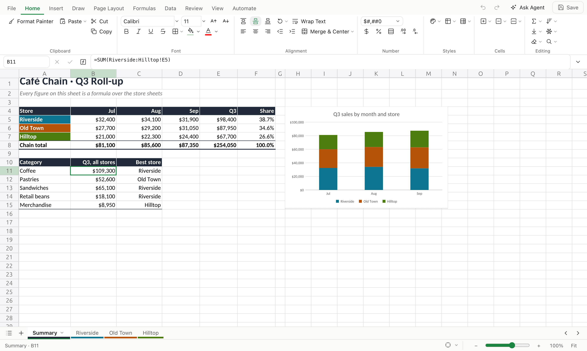
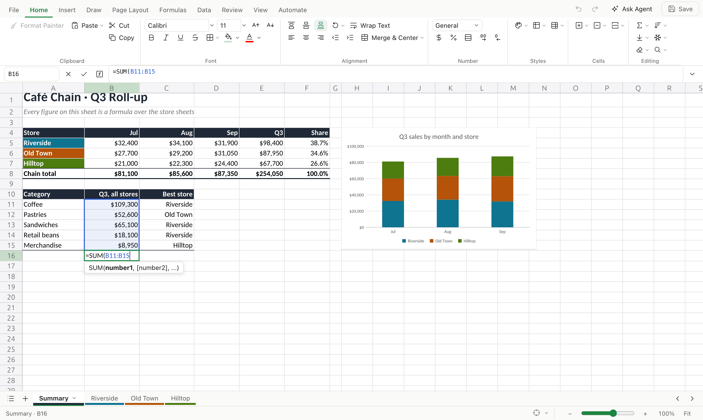
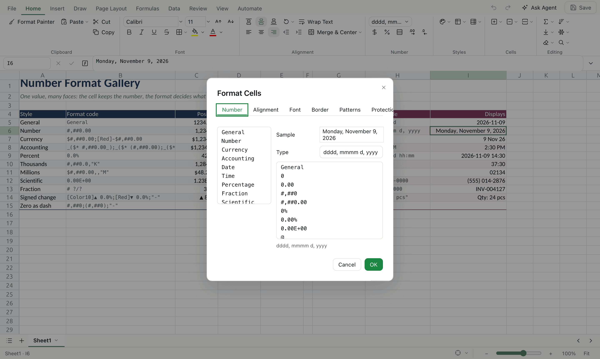
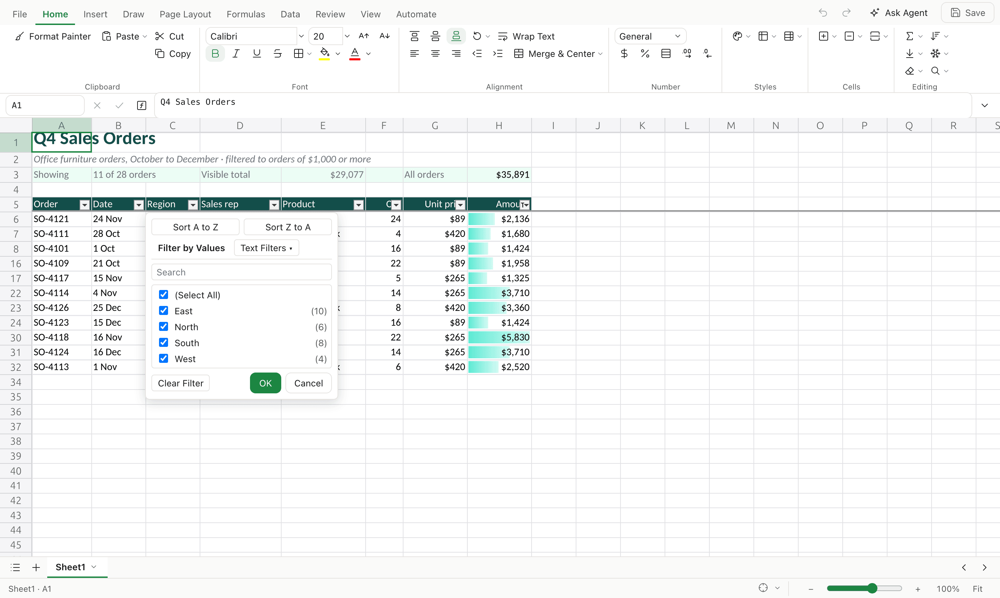
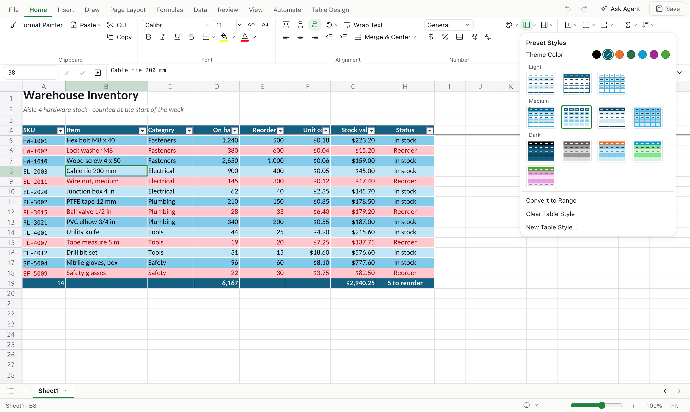
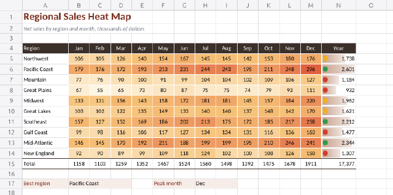
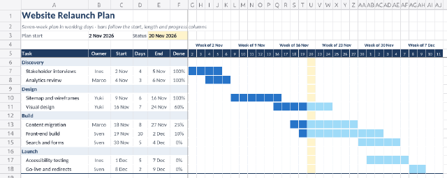
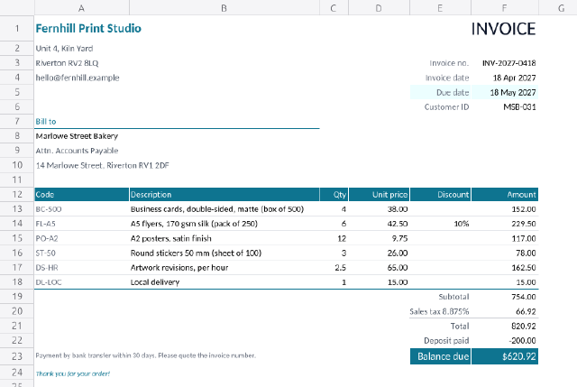
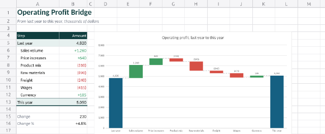

<div align="center">

# Kition Sheet

**Kition Sheet: a spreadsheet editor for .xlsx files with formulas, for people and AI agents**

Formulas · Number formats · Filters and sorting · Table styles · Many sheets · Agent tools with checks

[](LICENSE)
[](https://www.npmjs.com/package/@kition/embed)
[](https://github.com/kitharness/khp)
[](bindings/wasm)

[Use it in Kition](https://kition.ai) · [Embed it](#embed-it-in-your-app) · [Give it to your agent](#give-it-to-your-agent) · [Showcase](https://github.com/KitionAI/kition-showcase/tree/main/sheet) · [Developer docs](https://developer.kition.ai) · [KHP](https://github.com/kitharness/khp)

</div>

A workbook is a web of formulas. Insert a row, rename a sheet or sort a table, and every
reference has to follow. Many tools that open an `.xlsx` show the numbers but drop the formulas,
the formats or the second sheet. An AI agent has it worse: it sees cells as text, and cannot tell
a total from a number someone typed.

Kition Sheet is a spreadsheet built around the `.xlsx` file. You work in a grid, with a ribbon, a
formula bar and sheet tabs. An AI agent works on the same workbook through tools that run the same
engine and the same commands. It writes formulas, reads back what they compute, and asks the
kit's check for errors.



## What it does

### Why Sheet

- **Formulas you can trust.** Common functions give the reference results, to 15 significant
  digits. References stay right when you insert, delete, copy, cut or sort, and when you rename
  or move a sheet.
- **Type formulas the way you expect.** Point at cells and see each range outlined in its colour.
  Pick a function from the list, read its arguments as you type, and press F4 to make a reference absolute.
- **Numbers that look like what they are.** Currency, accounting, percent, dates and your own
  format codes; fonts, fills, borders, merged and wrapped cells; table styles by theme colour.
- **Find the rows you need.** Filter buttons list a column's values with their counts, and take
  text and number conditions. Validation lists offer the allowed entries in the cell.
- **An agent works on the same workbook.** It names the sheet it acts on, so it never moves your
  selection. It writes values and formulas, reads them back, and fixes what the check reports.
  Its edits can go to a draft that you review and merge.
- **Open source, in Rust.** Apache-2.0, engine and editor. The engine is compiled to WebAssembly
  and runs in a Web Worker, off your page's main thread.

### See it

<table>
<tr>
<td width="50%"><br /><b>Formulas</b>: the range you name is outlined in its colour, and the function's arguments appear as you type.</td>
<td width="50%"><br /><b>Number formats</b>: currency, percent, dates and your own format codes, with a sample before you apply them.</td>
</tr>
<tr>
<td width="50%"><br /><b>Filters</b>: sort a column, or keep the rows you want from its values, with how many rows hold each.</td>
<td width="50%"><br /><b>Table styles</b>: format a range as a table and pick a style by theme colour, or make your own.</td>
</tr>
</table>

### Made with Sheet

<table>
<tr>
<td width="25%"><a href="https://github.com/KitionAI/kition-showcase/tree/main/sheet/regional-sales-heat-map"></a></td>
<td width="25%"><a href="https://github.com/KitionAI/kition-showcase/tree/main/sheet/website-relaunch-gantt"></a></td>
<td width="25%"><a href="https://github.com/KitionAI/kition-showcase/tree/main/sheet/print-shop-invoice"></a></td>
<td width="25%"><a href="https://github.com/KitionAI/kition-showcase/tree/main/sheet/profit-bridge-waterfall"></a></td>
</tr>
</table>

Every sample is built with Sheet's own commands. [See all of them](https://github.com/KitionAI/kition-showcase/tree/main/sheet).

### Formats

| Opens | Creates | Exports |
| --- | --- | --- |
| `.xlsx`, `.xlsm` (edits and saves them); `.xltx`, `.xltm`, `.xls`, `.xlt`, `.et`, `.ett`, `.xlsb`, `.ods`, `.csv` (to read) | `.xlsx` | `.pdf`, `.csv`, `.html`, `.png`, `.xltx` |

## Quick start

### Use it in Kition

In Kition, an `.xlsx` workbook opens in this editor. Kition's agent edits the same workbook with
the kit's `sheet_*` tools. [Download Kition](https://github.com/KitionAI/kition/releases/latest).

### Embed it in your app

Sheet's editor is a static package you host yourself, mounted into your page with
[`@kition/embed`](https://www.npmjs.com/package/@kition/embed). You keep the files and the users;
the editor reads and writes through the functions you give it.

1. Download `kition-sheet-<version>.tgz` from the
   [latest release](https://github.com/KitionAI/kition-sheet/releases/latest) and serve its
   `sheet-ui/` folder as static files on its own origin, with the headers in the
   [embed reference](https://github.com/KitionAI/kition-sdk/blob/main/docs/platform/reference/embed.md).
2. Install the SDK and mount the editor:

```sh
npm install @kition/embed
```

```ts
import { KitionEmbed } from '@kition/embed'

const editor = await KitionEmbed.mount(document.getElementById('sheet')!, {
  kit: { id: 'kit.sheet', url: 'https://kits.example.com/sheet-ui/' }, // the package you host
  file: { id: 'q3-rollup', name: 'Q3 roll-up.xlsx' },
  storage: {
    read: async (id) => api.read(id),                    // { bytes, version }
    write: async (id, bytes, { expectedVersion }) =>     // refuse a stale version
      api.write(id, bytes, expectedVersion),             // { version }
  },
})
```

Every save carries the version it read, so an edit made elsewhere is never written over. Identity
and permissions, co-editing, and an agent's draft reviewed in your page are in the
[embed guide](https://github.com/KitionAI/kition-sdk/blob/main/docs/sdk/embed.md).

### Give it to your agent

The engine also runs headless as the `kition-sheet` program, and the SDK's `kition-kits-mcp` turns
it into MCP tools (`sheet_inspect`, `sheet_run`, `sheet_check`, …) on a folder of workbooks, for
any MCP client:

```sh
cargo build --release -p kition-sheet
cargo install --git https://github.com/KitionAI/kition-sdk kition-kits --bin kition-kits-mcp
kition-kits-mcp --workspace <folder of workbooks> --kit target/release/kition-sheet
```

A real session on a copy of the showcase's café chain roll-up, abridged:

```text
> sheet_inspect {"path":"rollup.xlsx","preview":false}
Opened `rollup.xlsx`: 1916 × 2158
{"content":{"columns":["A","B","C","D","E","F"],"range":"A1:F15","rows":[[1,"Café Chain · Q3 Roll-up",null,null,null,null,null], …
  [8,"Chain total",81100.0,85600.0,87350.0,254050.0,1.0], …
  [15,"Merchandise",8950.0,"Hilltop",null,null,null]],"sheet":"Summary"},
 "details":{…,"sheets":["Summary","Riverside","Old Town","Hilltop"],…},"revision":"hpr0",…}

> sheet_run {"path":"rollup.xlsx","basis":"hpr0","steps":[
    {"command":"range.setValues","params":{"range":"Summary!A16","values":[["All categories","=SUM(B11:B15)"]]}},
    {"command":"sheet.read","params":{"range":"Summary!A16:B16"}}]}
Ran 2 commands on `rollup.xlsx` (saved): 1916 × 2158 Changes: objects 3 created, 2 changed.
{…,"completed":[{"command":"range.setValues","result":{"cells":2}},
  {"changed":false,"command":"sheet.read","result":{"range":"A16:B16","sheet":"Summary","values":[["All categories",254050]]}}],
 …,"revision":"hpr1","saved":true}

> sheet_check {"path":"rollup.xlsx"}
Checked `rollup.xlsx`: the kit found nothing wrong.
{"diagnostics":[]}
```

The agent added a total under the categories as a formula, not a typed number, and read it back:
254,050, the same as the chain total above it. Every write names the revision it read (`basis`),
so a write over something another writer has since changed is refused. The agent's guide is
[agent/guide.md](agent/guide.md).

## Maturity

Version 0.1.0 · KHP 1.0, conformance level `basic`.

| Works today | Partly there | Not yet |
| --- | --- | --- |
| Entering values and formulas; results to 15 digits<br />References that follow inserts, deletes, copies, sorts and sheet renames<br />Number formats, fonts, fills, borders, alignment and merging<br />Filter buttons, validation lists, table styles, frozen panes<br />Sheets: insert, rename, colour, move, hide; agent tools with drafts | Charts and pivot tables<br />Conditional formatting<br />Comments and notes<br />Export to PDF, CSV and web page; printing and page setup<br />Text to columns, subtotals and Goal Seek | Password-protected workbooks<br />Saving as `.xls`, `.ods` or `.xlsb` (they open read-only)<br />Key tips and scrollbars in the editor<br />Slicers, calculated fields and pivot charts<br />Shaping for Arabic, Devanagari and Thai text |

Known gaps: [docs/gaps.md](docs/gaps.md). What's next: [docs/roadmap.md](docs/roadmap.md).

## Build and contribute

Build and test instructions are in [docs/development.md](docs/development.md). Read
[CONTRIBUTING.md](.github/CONTRIBUTING.md) before opening a pull request, and ask questions in
[Discussions](https://github.com/KitionAI/kition/discussions) or on [Discord](https://discord.gg/bFSjRDjVY).

## License

Apache-2.0 ([LICENSE](LICENSE)). Third-party licenses and notices are listed in [NOTICE](NOTICE)
and [docs/attribution.md](docs/attribution.md).

Portions of this kit are derived from a project dual-licensed under MIT or Apache-2.0, used here
under the MIT License and credited in [NOTICE](NOTICE).
